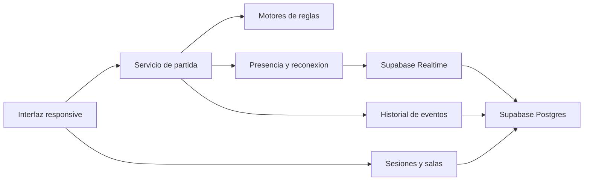

# Diseño técnico

## Estado de diseño

Las reglas de producto están confirmadas. Para equilibrar rapidez de desarrollo, mantenimiento y coste, la fundación visual usa React + TypeScript + Vite. La persistencia digital se realizará con Supabase Postgres, la sincronización de salas con Supabase Realtime y el acceso se limitará mediante RLS. La PWA y el resto de integración se incorporarán por fases sin implementar en esta etapa documental.

Comandos de la fundación actual:

- `npm install`: instala las dependencias del frontend.
- `npm run check`: ejecuta el chequeo de tipos.
- `npm run build`: genera la compilación de producción con Vite.
- `npm run dev`: inicia el servidor local de revisión.

### Publicación en GitHub Pages

El frontend se publica como sitio estático en `https://ivangb-626.github.io/card-games/`. La configuración de Vite usa `base: '/card-games/'` solo en el modo explícito `pages` para que los recursos apunten al subdirectorio correcto de GitHub Pages. Los despliegues locales y en Vercel usan `base: '/'`.

El workflow `.github/workflows/deploy-pages.yml` instala las dependencias, ejecuta el chequeo de tipos, genera `dist/` con `npm run build -- --mode pages` y publica el artefacto mediante GitHub Pages. Se ejecuta al hacer push a `main` y también puede iniciarse manualmente desde Actions.

La navegación actual cambia estado dentro de una sola página y no usa rutas profundas. Por este motivo, no es necesario añadir una página `404.html` ni compatibilidad con rutas SPA en esta fase.

## Componentes propuestos

El diseño inicial se organiza alrededor de estas responsabilidades:

## Dominio recomendado

### Carta

Representa un palo, valor y metadatos visuales. Debe ser independiente del motor de reglas y de la imagen concreta usada.

### Baraja

Define el conjunto de cartas, reverso, asignación de palos y reglas visuales. Debe soportar baraja española y americana sin mezclarlas en un único tipo.

### Jugador
Representa una posición en la mesa y una identidad local persistida. Inicialmente será invitado sin registro. El login futuro debe quedar detrás de una interfaz de identidad intercambiable para añadir amigos y perfiles sin alterar el motor.

### Sala

Agrupa jugadores, configuración, estado de partida y política de acceso. Una sala privada rechaza participantes sin código o enlace válido y expira a los 30 minutos. El creador recibe el rol de administrador.

### Partida

Agrupa configuración, jugadores, rondas y puntuación. Debe tener identificadores estables para reconectar.

### Ronda

Contiene el estado derivado de una ronda y checkpoints para corrección controlada. Deshacer restaura un checkpoint o reconstruye el estado sin eliminar ni alterar los eventos originales.

### Turno

Representa el jugador activo y las acciones permitidas. El cambio de turno debe validarse en el dominio, no depender únicamente de la interfaz.

## Separación de responsabilidades

- **Interfaz:** presenta estado, captura acciones y muestra errores.
- **Dominio:** valida acciones, aplica reglas y produce nuevo estado.
- **Sala:** controla acceso, jugadores presentes y reincorporación.
- **Persistencia:** guarda eventos, checkpoints y el estado necesario para recuperar una partida en Supabase Postgres.
- **Sincronización:** distribuye cambios a los clientes conectados mediante Supabase Realtime.
- **Autorización:** RLS permite que cada jugador consulte y modifique únicamente las salas a las que pertenece.

## Reglas y estado

El estado de juego debe ser inmutable o reproducible. Cada acción válida se guarda cronológicamente como evento con jugador, tipo, datos, versión y fecha. El estado visible se deriva de esa secuencia y de los checkpoints de cada ronda.

Las acciones rechazadas deben conservar el estado original y devolver una razón visible. Los cambios de interfaz nunca deben alterar la puntuación directamente.

En el modo físico, el cierre exige un puntaje entero para cada jugador. La interfaz muestra el resumen y los acumulados resultantes antes de confirmar; la confirmación añade los puntajes a la tabla de rondas, actualiza los acumulados, avanza la ronda y limpia los borradores. El siguiente turno conserva el jugador activo y el historial de turnos de la ronda cerrada se limpia.

Las acciones físicas reversibles de la ronda se apilan en el dominio. Deshacer restaura el turno y los borradores al estado previo a la última acción; la opción de deshacer toda la ronda restaura el estado anterior a la primera acción reversible y pide confirmación en la interfaz. Las modificaciones consecutivas del mismo campo de puntuación se agrupan como una sola acción para que la edición teclado-a-teclado se revierta completa. Al confirmar el cierre se limpia esta pila; la edición de puntos ya confirmados no forma parte del deshacer normal de la ronda.

## Deshacer

Se mantiene un historial de acciones dentro de la ronda:

- Todas las acciones de una ronda pueden deshacerse mientras esta no haya sido confirmada.
- Cada ronda conserva checkpoints; deshacer restaura el checkpoint correspondiente sin alterar el historial original de eventos.
- Al confirmar la ronda, solo el creador/administrador puede deshacer cualquier acción posterior permitida por la política de cierre.
- Un deshacer debe restaurar estado, turno, puntos y cartas derivadas.
- Debe mostrar la acción revertida y conservar la trazabilidad técnica completa mediante eventos y versiones.
- Las variantes configurables no pueden desactivar por código las reglas mínimas sin una configuración válida.

## Reconexión

El modelo mínimo debe distinguir:

- Jugador desconectado.
- Jugador reencontrado.
- Jugador marcado como ausente.
- Jugador eliminado o expulsado.
- Sala expirada.
- Si un jugador no vuelve durante 30 segundos, la partida queda pausada indefinidamente.
- El anfitrión puede jugar temporalmente por el jugador ausente o expulsarlo.
- El anfitrión no recibe ventajas en reglas, turnos, fichas ni resolución.

Una reconexión válida recupera asiento, identidad local, puntos y estado para continuar desde la siguiente ronda. La sala expira a los 30 minutos.

## Persistencia e invitaciones

- La identidad temporal se mantiene en el dispositivo mediante almacenamiento local persistente.
- El enlace puede contener o derivar un código corto de invitación.
- Los códigos y enlaces de invitación caducan a las 24 horas.
- El QR se considera mejora futura y no bloquea el MVP.
- Persistir eventos, checkpoints y estado necesario tras cerrar el navegador.
- El modo físico debe conservar estado suficiente para continuar sin red. La sincronización con el modo digital no forma parte del primer hito.

## Seguridad mínima

- Validar toda acción en el servidor o en un motor autoritativo.
- No confiar en puntos, turnos o barajas enviados por el cliente.
- Restringir acciones a miembros invitados de la sala.
- Generar identificadores difíciles de adivinar.
- Mantener fuera de estadísticas de producto cualquier dato técnico temporal.
- Preparar cabeceras, formularios y enlaces contra usos no previstos.

## Arquitectura escalable

La base debe permitir, sin reescribir el dominio:

- Nuevos tipos de baraja.
- Nuevos motores de juego.
- Nuevas reglas por variante.
- Login futuro detrás de una identidad intercambiable.
- Persistencia adicional.
- Observabilidad técnica sin perfiles públicos ni estadísticas de producto.

## Alternativas pendientes

| Decisión | Opciones posibles | Estado |
|---|---|---|
| Frontend | React + TypeScript + Vite para la fundación visual | Decidido para fase 1 |
| Backend | Supabase como servicio administrado para persistencia, autorización y sincronización | Decidido |
| Tiempo real | Supabase Realtime para cambios de salas | Decidido |
| Persistencia | Supabase Postgres con eventos y checkpoints | Decidido |
| Acceso | RLS por pertenencia a sala | Decidido |
| Reenganche | Detalle de variantes y empates | Pendiente |

## Pruebas recomendadas

- Tests unitarios para barajas, turnos, rondas y puntuación.
- Tests de reglas para chinchón y póker.
- Tests de reconexión, pausa indefinida, sustitución temporal, expulsión y expiración.
- Tests de eventos, versiones, checkpoints y restauración sin mutar el historial.
- Tests de RLS para acceso autorizado y no autorizado a salas.
- Tests de invitación y acceso no autorizado.
- Tests responsive de rutas principales.
- Tests de accesibilidad de teclado y contraste.
- Pruebas manuales de deshacer y cierre de ronda.
