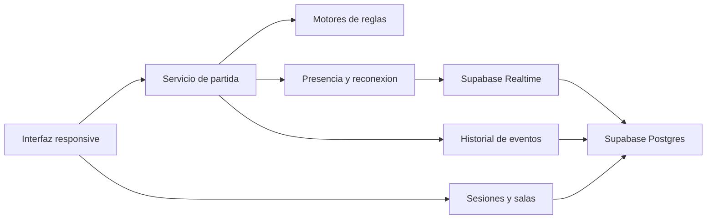

# Diseño técnico

## Estado de diseño

Las reglas de producto están confirmadas. Para equilibrar rapidez de desarrollo, mantenimiento y coste, la fundación visual usa React + TypeScript + Vite. La persistencia digital se realizará con Supabase Postgres, la sincronización de salas con Supabase Realtime y el acceso se limitará mediante RLS. La PWA y el resto de integración se incorporarán por fases sin implementar en esta etapa documental.

Comandos de la fundación actual:

- `npm install`: instala las dependencias del frontend.
- `npm run check`: ejecuta el chequeo de tipos.
- `npm run build`: genera la compilación de producción con Vite.
- `npm run dev`: inicia el servidor local de revisión.

### Publicación en GitHub Pages

El frontend se publica como sitio estático en `https://ivangb-626.github.io/card-games/`. La configuración de Vite usa `base: '/card-games/'` solo en el modo explícito `pages` para que los recursos apunten al subdirectorio correcto de GitHub Pages. Los despliegues locales y en Vercel usan `base: '/'`.

El workflow `.github/workflows/deploy-pages.yml` instala las dependencias, ejecuta el chequeo de tipos, genera `dist/` con `npm run build -- --mode pages` y publica el artefacto mediante GitHub Pages. Se ejecuta al hacer push a `main` y también puede iniciarse manualmente desde Actions.

La navegación actual cambia estado dentro de una sola página y no usa rutas profundas. Por este motivo, no es necesario añadir una página `404.html` ni compatibilidad con rutas SPA en esta fase.

### Publicación en Vercel

Vercel puede desplegar el mismo build normal de Vite con `base: '/'`. El workflow `.github/workflows/deploy-vercel.yml` ofrece previews controladas para pull requests y despliegue a producción desde `main` o desde ejecución manual.

La tarea de producción usa el entorno protegido `vercel-production`. Antes del primer despliegue debe existir en GitHub un entorno con ese nombre y las reglas de aprobación deseadas. Los despliegues a producción quedan bloqueados hasta que el entorno esté aprobado.

Configuración requerida en GitHub Actions:

- Crear los secrets `VERCEL_TOKEN`, `VERCEL_ORG_ID` y `VERCEL_PROJECT_ID`.
- Registrar los secretos en el repositorio o en el entorno `vercel-production`, según la política de acceso elegida.
- La integración de Vercel debe tener habilitado el proyecto correspondiente y permitir que el token identificado pueda leer y desplegar ese proyecto.
- No añadir los valores a archivos del repositorio ni a logs de workflow.

Este workflow no sustituye ni modifica el despliegue existente de GitHub Pages. Tampoco añade Supabase, migraciones, login ni estadísticas.

## Componentes propuestos

El diseño inicial se organiza alrededor de estas responsabilidades:

## Dominio recomendado

### Carta

Representa un palo, valor y metadatos visuales. Debe ser independiente del motor de reglas y de la imagen concreta usada.

### Baraja

Define el conjunto de cartas, reverso, asignación de palos y reglas visuales. Debe soportar baraja española y americana sin mezclarlas en un único tipo.

### Jugador
Representa una posición en la mesa y una identidad local persistida. Inicialmente será invitado sin registro. El login futuro debe quedar detrás de una interfaz de identidad intercambiable para añadir amigos y perfiles sin alterar el motor.

### Sala

Agrupa jugadores, configuración, estado de partida y política de acceso. Una sala privada rechaza participantes sin código o enlace válido y expira a los 30 minutos. El creador recibe el rol de administrador.

### Partida

Agrupa configuración, jugadores, rondas y puntuación. Debe tener identificadores estables para reconectar.

### Ronda

Contiene el estado derivado de una ronda y checkpoints para corrección controlada. Deshacer restaura un checkpoint o reconstruye el estado sin eliminar ni alterar los eventos originales.

### Turno

Representa el jugador activo y las acciones permitidas. El cambio de turno debe validarse en el dominio, no depender únicamente de la interfaz.

## Separación de responsabilidades

- **Interfaz:** presenta estado, captura acciones y muestra errores.
- **Dominio:** valida acciones, aplica reglas y produce nuevo estado.
- **Sala:** controla acceso, jugadores presentes y reincorporación.
- **Persistencia:** guarda eventos, checkpoints y el estado necesario para recuperar una partida en Supabase Postgres.
- **Sincronización:** distribuye cambios a los clientes conectados mediante Supabase Realtime.
- **Autorización:** RLS permite que cada jugador consulte y modifique únicamente las salas a las que pertenece.

## Reglas y estado

El estado de juego debe ser inmutable o reproducible. Cada acción válida se guarda cronológicamente como evento con jugador, tipo, datos, versión y fecha. El estado visible se deriva de esa secuencia y de los checkpoints de cada ronda.

Las acciones rechazadas deben conservar el estado original y devolver una razón visible. Los cambios de interfaz nunca deben alterar la puntuación directamente.

El modo físico usa un modelo de marcador por rondas, sin turnos: jugadores, total acumulado por jugador, número de ronda, puntos de la ronda en curso (`null` mientras no se introducen) y si la ronda está cerrada. Reglas del dominio (`src/domain/physicalGame.ts`):

- Los puntos de ronda solo se editan con la ronda abierta y para jugadores en juego (total menor que 101).
- Los puntos de una ronda van de 0 a 70 (un valor mayor se recorta a 70) y, en negativo, solo pueden ser -10 o -50. Los ajustes de −/+ se mueven dentro de 0–70.
- `closeRound` exige los puntos de todos los jugadores en juego y suma cada uno al total, con un mínimo de -50.
- Llegar a -50 da la victoria y termina la partida. Llegar a 101 deja al jugador fuera.
- Con la ronda cerrada, sin ganador por -50 y con al menos dos jugadores en juego, un jugador fuera puede reengancharse: su total pasa a ser el mayor total entre los jugadores en juego. Al empezar la siguiente ronda ya no puede hacerlo hasta el siguiente cierre. Se cuentan los reenganches de cada jugador y se muestran entre rondas.
- Si al cerrar una ronda solo queda un jugador en juego, no hay opción de reenganche: la partida termina y ese jugador gana. Si no queda ninguno, gana el total más bajo.
- Cada cierre guarda un resumen de la ronda (puntos, totales y reenganches posteriores). Al terminar la partida se muestra una pantalla con el ganador, la clasificación, el resumen ronda a ronda y los botones «Nueva partida» y «Volver al inicio». Este resumen pertenece solo a la partida en curso y se borra al empezar otra; no es un historial ni estadísticas entre partidas.

La interfaz solo envía acciones al dominio y muestra el resultado. Ofrece botones rápidos −10, −50 y 0 (fijan ese valor), +5 y +10 (suman) y «Pasarse», que solo aparece cuando los puntos que faltan para llegar a 101 caben en una ronda y fija exactamente esa cantidad. Tras usar −10, −50, 0 o «Pasarse», cualquier otro cambio de ese jugador en la misma ronda pide confirmación; +5 y +10 no la activan. Durante la ronda y entre rondas, «Acabar partida» pide confirmación y lleva a la pantalla de resumen sin ganador, destacando a quien tiene menos puntos sin presentarlo como ganador. Si se acaba con una ronda abierta, sus puntos se descartan y el resumen solo incluye las rondas cerradas. El almacenamiento local (versión 8) persiste la ronda en curso, el resumen y los reenganches; la versión 7 se migra con el resumen vacío y las anteriores se migran a la ronda 1 conservando los totales (acotados a -50) y sumando los borradores pendientes de versiones antiguas.

## Chinchón digital

Primer hito jugable del modo digital. Lo que falta está en `TASKS.md`, Fase 4.

### Reglas

- Baraja española de 40 cartas (sin 8 ni 9) más 2 comodines; el 7 y la sota van seguidos. 2–4 jugadores, 7 cartas cada uno.
- Combinaciones: grupos del mismo número (3–4 cartas) o escaleras del mismo palo (3 o más). Como mucho un comodín por combinación y al menos dos cartas reales.
- En su turno, el jugador roba del mazo o del descarte y después descarta o cierra. Si el mazo se agota, se rebaraja el descarte dejando visible la última carta.
- Cerrar: se aparta una carta boca abajo y, con las otras 7, solo puede quedar una carta suelta que no sea comodín y valga 5 o menos.
- Puntos de quien cierra: −50 con chinchón (7 seguidas del mismo palo, sin comodín), −10 sin cartas sueltas o el valor de su carta suelta.
- Al cerrar, cada comodín queda fijo en la posición que ocupa. Si en una escalera puede ir por cualquiera de los dos extremos (por ejemplo, junto a 7 y sota puede ser 6 o caballo), quien cierra elige. Con el comodín como 6, un rey ya no puede ligarse a 7-sota.
- Ligar: tras el cierre, los demás colocan a la vez sus cartas sueltas en las combinaciones de quien cerró y pulsan «Listo». Solo se puede ligar por los extremos de una escalera o completar un grupo, respetando la posición del comodín. Un comodín ligado a una escalera ocupa el extremo superior si está libre. La interfaz no indica qué cartas encajan: el servidor valida cada intento. Se puede devolver una carta mientras no rompa una combinación que otro haya seguido ampliando.
- Con un cierre de −10 o −50 (sin cartas sueltas) no se liga: la ronda se puntúa al cerrar.
- Los demás suman sus puntos sueltos, con la mejor combinación posible de las cartas no ligadas. El comodín suelto vale 25 y las figuras 10.
- El marcador entre rondas reutiliza las reglas del modo físico (`physicalGame.ts`): tope de 70 por ronda, mínimo de −50 (gana), fuera a partir de 101 y reenganche entre rondas si quedan al menos dos jugadores en juego.
- Con la partida empezada se puede entrar en la sala solo entre rondas, hasta 4 jugadores. Quien entra lo hace con la puntuación más alta de los que siguen en juego y juega desde la siguiente ronda.
- La siguiente ronda empieza cuando el anfitrión la inicia o cuando dos jugadores no anfitriones pulsan «Listo» (uno si solo hay uno). Empieza el siguiente jugador en juego de la mesa.
- Al terminar cada ronda se muestran todas las manos.

### Arquitectura

- Motor puro y compartido: `src/domain/chinchon.ts` (cartas y combinaciones), `src/domain/physicalGame.ts` (marcador) y `src/domain/digitalChinchon.ts` (estado de la partida, jugadas y vistas). No tienen dependencias e importan con extensión `.ts` para que Deno los resuelva.
- Árbitro: la Edge Function `supabase/functions/chinchon-game` autentica al invitado, aplica la jugada con el motor y llama a `save_chinchon_game`, que guarda de forma atómica y con versión optimista.
- `npm run sync:edge` copia el motor a `supabase/functions/_shared/`; un test falla si las copias no coinciden.
- Datos:
  - `room_games` guarda el estado completo y solo es accesible con `service_role`.
  - `room_game_public` guarda la vista común y la pueden leer los miembros de la sala.
  - `room_game_hands` guarda una fila por jugador que solo puede leer su dueño.
  - Las dos últimas, junto con `rooms` y `room_members`, se sincronizan con Supabase Realtime.
- Las políticas RLS comprueban la pertenencia con `private.is_room_member` y `private.is_own_member` (security definer). Una política de `room_members` no puede consultar `room_members` directamente, porque Postgres lo rechaza por recursión.
- En este proyecto las tablas nuevas no reciben permisos por defecto: cada migración que cree una tabla debe conceder `select` a `authenticated` (si la leen los clientes, siempre con RLS) y a `service_role` (si la usa la Edge Function). Sin permisos, ni Realtime ni la Edge Function ven los datos.
- Además de Realtime, la sala se relee cada 5 s y la partida cada 4 s como respaldo.
- Cada jugada válida queda en `room_events` con jugador, tipo, datos y versión; la carta con la que se cierra no se registra porque está boca abajo.
- Una vez empezada la partida, `join_private_room` solo admite jugadores nuevos cuando la vista común está en `round-ended`. El cliente nuevo envía `join-game` y la Edge Function lo sienta (`addLateSeats`), lo que también ocurre en cualquier otra jugada de ese intervalo. Cada jugada mantiene viva la sala 30 minutos más.
- Reconexión básica: el dispositivo recuerda la última sala y, al recargar, vuelve a entrar con la misma identidad local.
- Despliegue: `docs/DEPLOY_SUPABASE.md`.

## Deshacer

Se mantiene un historial de acciones dentro de la ronda:

- Todas las acciones de una ronda pueden deshacerse mientras esta no haya sido confirmada.
- Cada ronda conserva checkpoints; deshacer restaura el checkpoint correspondiente sin alterar el historial original de eventos.
- Al confirmar la ronda, solo el creador/administrador puede deshacer cualquier acción posterior permitida por la política de cierre.
- Un deshacer debe restaurar estado, turno, puntos y cartas derivadas.
- Debe mostrar la acción revertida y conservar la trazabilidad técnica completa mediante eventos y versiones.
- Las variantes configurables no pueden desactivar por código las reglas mínimas sin una configuración válida.

## Reconexión

El modelo mínimo debe distinguir:

- Jugador desconectado.
- Jugador reencontrado.
- Jugador marcado como ausente.
- Jugador eliminado o expulsado.
- Sala expirada.
- Si un jugador no vuelve durante 30 segundos, la partida queda pausada indefinidamente.
- El anfitrión puede jugar temporalmente por el jugador ausente o expulsarlo.
- El anfitrión no recibe ventajas en reglas, turnos, fichas ni resolución.

Una reconexión válida recupera asiento, identidad local, puntos y estado para continuar desde la siguiente ronda. La sala expira a los 30 minutos.

## Persistencia e invitaciones

- La identidad temporal se mantiene en el dispositivo mediante almacenamiento local persistente.
- El enlace puede contener o derivar un código corto de invitación.
- Los códigos y enlaces de invitación caducan a las 24 horas.
- El QR se considera mejora futura y no bloquea el MVP.
- Persistir eventos, checkpoints y estado necesario tras cerrar el navegador.
- El modo físico debe conservar estado suficiente para continuar sin red. La sincronización con el modo digital no forma parte del primer hito.

## Seguridad mínima

- Validar toda acción en el servidor o en un motor autoritativo.
- No confiar en puntos, turnos o barajas enviados por el cliente.
- Restringir acciones a miembros invitados de la sala.
- Generar identificadores difíciles de adivinar.
- Mantener fuera de estadísticas de producto cualquier dato técnico temporal.
- Preparar cabeceras, formularios y enlaces contra usos no previstos.

## Arquitectura escalable

La base debe permitir, sin reescribir el dominio:

- Nuevos tipos de baraja.
- Nuevos motores de juego.
- Nuevas reglas por variante.
- Login futuro detrás de una identidad intercambiable.
- Persistencia adicional.
- Observabilidad técnica sin perfiles públicos ni estadísticas de producto.

## Alternativas pendientes

| Decisión | Opciones posibles | Estado |
|---|---|---|
| Frontend | React + TypeScript + Vite para la fundación visual | Decidido para fase 1 |
| Backend | Supabase como servicio administrado para persistencia, autorización y sincronización | Decidido |
| Tiempo real | Supabase Realtime para cambios de salas | Decidido |
| Persistencia | Supabase Postgres con eventos y checkpoints | Decidido |
| Acceso | RLS por pertenencia a sala | Decidido |
| Reenganche | Detalle de variantes y empates | Pendiente |

## Pruebas recomendadas

- Tests unitarios para barajas, turnos, rondas y puntuación.
- Tests de reglas para chinchón y póker.
- Tests de reconexión, pausa indefinida, sustitución temporal, expulsión y expiración.
- Tests de eventos, versiones, checkpoints y restauración sin mutar el historial.
- Tests de RLS para acceso autorizado y no autorizado a salas.
- Tests de invitación y acceso no autorizado.
- Tests responsive de rutas principales.
- Tests de accesibilidad de teclado y contraste.
- Pruebas manuales de deshacer y cierre de ronda.
