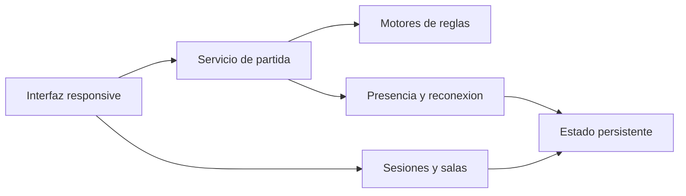

# Diseño técnico

## Estado de diseño

Las reglas de producto están confirmadas. Para equilibrar rapidez de desarrollo, mantenimiento y coste, la fundación visual usa React + TypeScript + Vite. Esta decisión cubre únicamente el frontend de la fase 1; la PWA completa, el backend Node.js, WebSockets, PostgreSQL y el proveedor concreto de alojamiento, base de datos y tiempo real quedan pendientes de una fase posterior.

Comandos de la fundación actual:

- `npm install`: instala las dependencias del frontend.
- `npm run check`: ejecuta el chequeo de tipos.
- `npm run build`: genera la compilación de producción con Vite.
- `npm run dev`: inicia el servidor local de revisión.

### Publicación en GitHub Pages

El frontend se publica como sitio estático en `https://ivangb-626.github.io/card-games/`. La configuración de Vite usa `base: '/card-games/'` solo en el modo explícito `pages` para que los recursos apunten al subdirectorio correcto de GitHub Pages. Los despliegues locales y en Vercel usan `base: '/'`.

El workflow `.github/workflows/deploy-pages.yml` instala las dependencias, ejecuta el chequeo de tipos, genera `dist/` con `npm run build -- --mode pages` y publica el artefacto mediante GitHub Pages. Se ejecuta al hacer push a `main` y también puede iniciarse manualmente desde Actions.

La navegación actual cambia estado dentro de una sola página y no usa rutas profundas. Por este motivo, no es necesario añadir una página `404.html` ni compatibilidad con rutas SPA en esta fase.

## Componentes propuestos

El diseño inicial se organiza alrededor de estas responsabilidades:

## Dominio recomendado

### Carta

Representa un palo, valor y metadatos visuales. Debe ser independiente del motor de reglas y de la imagen concreta usada.

### Baraja

Define el conjunto de cartas, reverso, asignación de palos y reglas visuales. Debe soportar baraja española y americana sin mezclarlas en un único tipo.

### Jugador
Representa una posición en la mesa y una identidad local persistida. Inicialmente será invitado sin registro. El login futuro debe quedar detrás de una interfaz de identidad intercambiable para añadir amigos y perfiles sin alterar el motor.

### Sala

Agrupa jugadores, configuración, estado de partida y política de acceso. Una sala privada rechaza participantes sin código o enlace válido y expira a los 30 minutos. El creador recibe el rol de administrador.

### Partida

Agrupa configuración, jugadores, rondas y puntuación. Debe tener identificadores estables para reconectar.

### Ronda

Contiene el estado mutable de una ronda y permite guardar checkpoints de corrección controlada.

### Turno

Representa el jugador activo y las acciones permitidas. El cambio de turno debe validarse en el dominio, no depender únicamente de la interfaz.

## Separación de responsabilidades

- **Interfaz:** presenta estado, captura acciones y muestra errores.
- **Dominio:** valida acciones, aplica reglas y produce nuevo estado.
- **Sala:** controla acceso, jugadores presentes y reincorporación.
- **Persistencia:** guarda el estado necesario para recuperar una partida.
- **Sincronización:** distribuye cambios a los clientes conectados.

## Reglas y estado

El estado de juego debe ser inmutable o reproducible. Cada acción que cambie una ronda debe incluir jugador, acción, versión y marca de tiempo o una estructura equivalente.

Las acciones rechazadas deben conservar el estado original y devolver una razón visible. Los cambios de interfaz nunca deben alterar la puntuación directamente.

## Deshacer

Se mantiene un historial de acciones dentro de la ronda:

- Todas las acciones de una ronda pueden deshacerse mientras esta no haya sido confirmada.
- Al confirmar la ronda, solo el creador/administrador puede deshacer cualquier acción posterior permitida por la política de cierre.
- Un deshacer debe restaurar estado, turno, puntos y cartas derivadas.
- Debe mostrar la acción revertida y conservar una trazabilidad técnica limitada a la sesión.
- Las variantes configurables no pueden desactivar por código las reglas mínimas sin una configuración válida.

## Reconexión

El modelo mínimo debe distinguir:

- Jugador desconectado.
- Jugador reencontrado.
- Jugador marcado como ausente.
- Jugador eliminado o expulsado.
- Sala expirada.
- Si la desconexión ocurre fuera del turno o el usuario elige ese estado, se muestra como ausente.
- Si el usuario pierde conexión durante su turno, queda documentado como caso operativo pendiente.

Una reconexión válida recupera asiento, identidad local, puntos y estado para continuar desde la siguiente ronda. La sala expira a los 30 minutos.

## Persistencia e invitaciones

- La identidad temporal se mantiene en el dispositivo mediante almacenamiento local persistente.
- El enlace puede contener o derivar un código corto de invitación.
- El QR se considera mejora futura y no bloquea el MVP.
- Persistir el estado necesario tras cerrar el navegador.
- El modo físico debe conservar estado suficiente para continuar sin red. La sincronización con el modo digital no forma parte del primer hito.

## Seguridad mínima

- Validar toda acción en el servidor o en un motor autoritativo.
- No confiar en puntos, turnos o barajas enviados por el cliente.
- Restringir acciones a miembros invitados de la sala.
- Generar identificadores difíciles de adivinar.
- Mantener fuera de estadísticas cualquier dato temporal.
- Preparar cabeceras, formularios y enlaces contra usos no previstos.

## Arquitectura escalable

La base debe permitir, sin reescribir el dominio:

- Nuevos tipos de baraja.
- Nuevos motores de juego.
- Nuevas reglas por variante.
- Login futuro detrás de una identidad intercambiable.
- Persistencia adicional.
- Observabilidad técnica sin perfiles públicos ni estadísticas de producto.

## Alternativas pendientes

| Decisión | Opciones posibles | Estado |
|---|---|---|
| Frontend | React + TypeScript + Vite para la fundación visual | Decidido para fase 1 |
| Backend | Servidor autoritativo, servicios modulares o solución administrada | Pendiente |
| Tiempo real | WebSockets, servicios administrados o sondeo | Pendiente |
| Persistencia | Documento, relacional o almacenamiento administrado | Pendiente |
| Proveedor | Alojamiento administrado o propio | Pendiente |
| Reenganche | Detalle de variantes y empates | Pendiente |

## Pruebas recomendadas

- Tests unitarios para barajas, turnos, rondas y puntuación.
- Tests de reglas para chinchón y póker.
- Tests de reconexión y expiración.
- Tests de invitación y acceso no autorizado.
- Tests responsive de rutas principales.
- Tests de accesibilidad de teclado y contraste.
- Pruebas manuales de deshacer y cierre de ronda.
