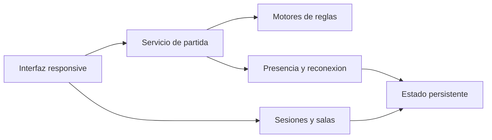

# Diseño técnico

## Estado de diseño

Las decisiones siguientes son confirmadas por el producto. El framework, el backend, la base de datos, el sistema de tiempo real y el proveedor de alojamiento permanecen como propuestas hasta que se confirme una selección.

## Componentes propuestos

El diseño inicial se organiza alrededor de estas responsabilidades:

## Dominio recomendado

### Carta

Representa un palo, valor y metadatos visuales. Debe ser independiente del motor de reglas y de la imagen concreta usada.

### Baraja

Define el conjunto de cartas, reverso, asignación de palos y reglas visuales. Debe soportar baraja española y americana sin mezclarlas en un único tipo.

### Jugador

Representa una posición en la mesa y una identidad de sesión. Inicialmente podrá ser invitado; el login futuro no debe afectar directamente al motor de juego.

### Sala

Agrupa jugadores, configuración, estado de partida y política de acceso. Una sala privada debe rechazar participantes sin invitación.

### Partida

Agrupa configuración, jugadores, rondas y puntuación. Debe tener identificadores estables para reconectar.

### Ronda

Contiene el estado mutable de una ronda y permite guardar checkpoints de corrección controlada.

### Turno

Representa el jugador activo y las acciones permitidas. El cambio de turno debe validarse en el dominio, no depender únicamente de la interfaz.

## Separación de responsabilidades

- **Interfaz:** presenta estado, captura acciones y muestra errores.
- **Dominio:** valida acciones, aplica reglas y produce nuevo estado.
- **Sala:** controla acceso, jugadores presentes y reincorporación.
- **Persistencia:** guarda el estado necesario para recuperar una partida.
- **Sincronización:** distribuye cambios a los clientes conectados.

## Reglas y estado

El estado de juego debe ser inmutable o reproducible. Cada acción que cambie una ronda debe incluir jugador, acción, versión y marca de tiempo o una estructura equivalente.

Las acciones rechazadas deben conservar el estado original y devolver una razón visible. Los cambios de interfaz nunca deben alterar la puntuación directamente.

## Deshacer

La propuesta inicial es mantener un historial limitado de acciones dentro de la ronda:

- Corregir solo acciones válidas de la misma ronda.
- No deshacer acciones que hayan sido confirmadas como cierre de ronda si las reglas acordadas no lo permiten.
- Mostrar quién realizó la corrección y qué cambió.
- Restaurar el estado derivado completo, no solo una etiqueta visual.
- Evitar deshacer turnos, puntos o cartas una vez finalizada la ronda, salvo una acción explícita de corrección definida.

La política final será una decisión confirmada antes de implementar el motor.

## Reconexión

El modelo mínimo debe distinguir:

- Jugador desconectado.
- Jugador reencontrado.
- Jugador eliminado o expulsado.
- Sala expirada.

Una reconexión debe recuperar el asiento, el turno correspondiente y el estado reciente. La selección de tolerancia de tiempo y caducidad requiere una decisión pendiente.

## Seguridad mínima

- Validar toda acción en el servidor o en un motor autoritativo.
- No confiar en puntos, turnos o barajas enviados por el cliente.
- Restringir acciones a miembros invitados de la sala.
- Generar identificadores difíciles de adivinar.
- Mantener fuera de estadísticas cualquier dato temporal.
- Preparar cabeceras, formularios y enlaces contra usos no previstos.

## Arquitectura escalable

La base debe permitir, sin reescribir el dominio:

- Nuevos tipos de baraja.
- Nuevos motores de juego.
- Nuevas reglas por variante.
- Login futuro detrás de una identidad intercambiable.
- Persistencia adicional.
- Observabilidad técnica sin perfiles públicos ni estadísticas de producto.

## Alternativas pendientes

| Decisión | Opciones posibles | Estado |
|---|---|---|
| Frontend | Framework SPA, SSR o híbrido | Pendiente |
| Backend | Servidor autoritativo, servicios modulares o solución administrada | Pendiente |
| Tiempo real | WebSockets, servicios administrados o sondeo | Pendiente |
| Persistencia | Documento, relacional o almacenamiento administrado | Pendiente |
| Invitación | Código, enlace, QR | Pendiente |
| Identidad | Invitado temporal, identidad persistente o login | Pendiente |

## Pruebas recomendadas

- Tests unitarios para barajas, turnos, rondas y puntuación.
- Tests de reglas para chinchón y póker.
- Tests de reconexión y expiración.
- Tests de invitación y acceso no autorizado.
- Tests responsive de rutas principales.
- Tests de accesibilidad de teclado y contraste.
- Pruebas manuales de deshacer y cierre de ronda.
