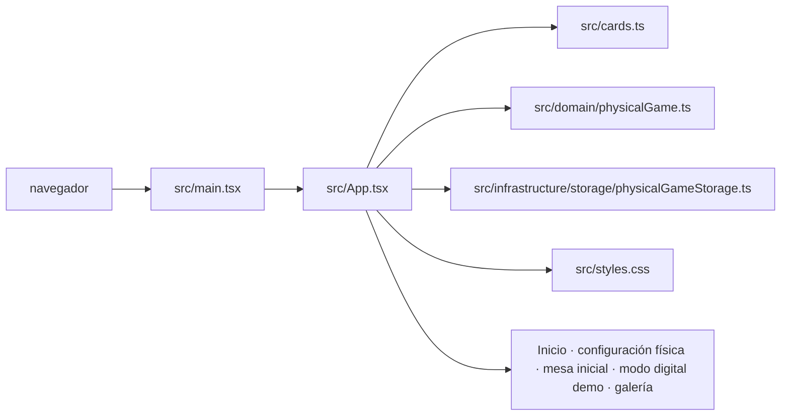
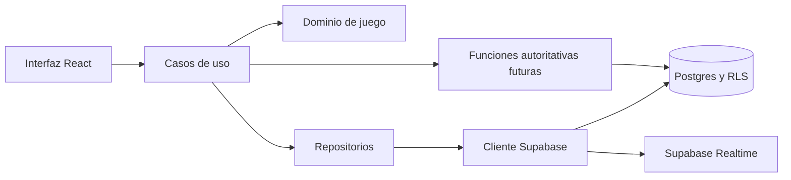

# Arquitectura actual

## Alcance implementado

El código actual es una SPA visual. React monta `App` desde `src/main.tsx`; `src/App.tsx` gestiona idioma, navegación, galería y la configuración/mesa inicial del modo físico. `src/domain/physicalGame.ts` valida los nombres y límites de jugadores, calcula el siguiente turno y permite deshacer avances registrados. `src/infrastructure/storage/physicalGameStorage.ts` guarda y recupera la mesa local con formato versionado y migración de la versión anterior. `src/cards.ts` aporta datos de muestra; `src/styles.css` concentra los estilos responsive.



No hay router. El modo digital usa Supabase: sesión anónima para invitados, funciones SQL para crear o entrar en salas, Realtime para sincronizar y la Edge Function `chinchon-game` como árbitro de la partida (ver `TECHNICAL_DESIGN.md`, «Chinchón digital»). La interfaz de la sala y la mesa está en `src/ui/DigitalChinchonRoom.tsx`; el acceso a datos, en `src/infrastructure/supabase/`. El modo físico permite configurar 2–4 jugadores (hasta 6 con aviso), introducir los puntos de cada ronda, cerrarla para acumularlos en los totales (mínimo -50, eliminación a 101), reengancharse entre rondas y recuperar la partida local. El modo digital continúa como demostración; las cartas son datos estáticos.

## Stack y publicación observados

- React 18 y TypeScript 5 con Vite 6.
- `npm run dev`, `npm run check`, `npm run build`, `npm test` (Vitest) y `npm run sync:edge` (copia el motor de dominio a la Edge Function) están definidos en `package.json`.
- El despliegue de migraciones y de la Edge Function se describe en `docs/DEPLOY_SUPABASE.md`.
- GitHub Pages publica con el modo Vite `pages`, que usa `base: '/card-games/'`. Los demás modos usan `/`.
- Existe un workflow de Pages que compila con Node 20. No detecta tests ni lint.
- Vercel `card-games` es el proyecto canónico acordado. Despliega el repositorio desde `main`; `card-games-ewao` se conserva sin cambios como proyecto duplicado hasta recibir una decisión específica.
- Supabase `card-games` es el backend previsto: ref `pqvoolwxgffdmxbvpujs`, región `eu-west-1`. Está activo, pero aún no tiene tablas, migraciones, políticas RLS ni integración en el código.

## Arquitectura objetivo aprobada

La futura integración mantiene el dominio independiente de React y Supabase. Supabase Postgres guardará eventos y checkpoints; Supabase Realtime sincronizará salas; RLS limitará el acceso por pertenencia a sala. Las acciones que afecten reglas, turnos, puntuaciones o invitaciones deben validarse en una capa autoritativa antes de persistirse.



### Responsabilidades por capa

- **Interfaz:** muestra estado, recibe acciones y comunica errores. No decide puntuaciones ni cambios de turno.
- **Aplicación:** coordina casos de uso, repositorios, presencia y errores recuperables.
- **Dominio:** contiene reglas de cartas, partidas, rondas, turnos, eventos y checkpoints. No importa React, Vite ni Supabase.
- **Infraestructura:** adapta Supabase a repositorios, Realtime y presencia sin filtrar detalles de red al dominio.
- **Funciones autoritativas futuras:** validan operaciones que no pueden confiar en el cliente, como acceso a sala, invitaciones, turnos, eventos y correcciones de ronda.

Cuando se autorice la implementación, la estructura prevista es:

```text
src/
  domain/
    game/
    room/
    identity/
  application/
    game-service.ts
    room-service.ts
  infrastructure/
    supabase/
      config.ts
      client.ts
      room-repository.ts
      realtime-room.ts
  hooks/
    use-room.ts
    use-presence.ts
```

Los nombres son una guía de organización; no son carpetas creadas ni una interfaz implementada.

## Integración futura de Supabase

La primera dependencia de cliente será `@supabase/supabase-js`. Incluye soporte para base de datos, Auth y Realtime; no se prevén dependencias adicionales de Supabase para la SPA Vite actual. `@supabase/ssr` no forma parte de esta dirección mientras el proyecto no incorpore renderizado en servidor.

`src/infrastructure/supabase/config.ts` deberá validar configuración antes de crear una instancia única del cliente en `client.ts`. La validación comprobará que existe la URL, que usa HTTPS y que el hostname corresponde a `pqvoolwxgffdmxbvpujs.supabase.co`, sin registrar claves ni valores sensibles.

La aplicación cliente usará únicamente una URL pública y una clave anon o publishable. Las claves de servidor, contraseñas y cualquier `service_role` vivirán exclusivamente en secretos de funciones autoritativas o de un backend aprobado; nunca en el navegador ni bajo un prefijo `VITE_`.

## Entornos y variables

| Entorno | Variables públicas previstas | Ubicación prevista | Estado actual |
|---|---|---|---|
| Development | `VITE_SUPABASE_URL`, `VITE_SUPABASE_ANON_KEY` | `.env.local`, excluido de Git | No hay archivos `.env*` ni variables locales. |
| Preview | mismas variables públicas | Vercel, ámbito Preview | Ambas variables están configuradas en `card-games`. |
| Production | mismas variables públicas | Vercel, ámbito Production | Ambas variables están configuradas en `card-games`. |

Los prefijos `VITE_` hacen que los valores se incorporen al bundle; solo se permiten la URL pública y una clave de cliente anon o publishable. Nunca se deben imprimir valores de variables, incluirlos en errores ni almacenarlos en documentación.

Preview y Production comparten actualmente las entradas de configuración de Vercel. Si se requiere aislamiento futuro, Preview debe usar un proyecto o rama Supabase distinta y variables específicas por entorno o rama. Development puede usar el proyecto confirmado solo para trabajo sin datos reales mientras no exista un entorno aislado autorizado.

## Decisiones pendientes antes de persistencia

- Definir el esquema de salas, jugadores, eventos, checkpoints e invitaciones.
- Definir las migraciones y la estrategia de ramas o proyecto de desarrollo de Supabase.
- Diseñar y probar políticas RLS por pertenencia a sala, incluidos invitados temporales y reconexión.
- Determinar qué operaciones irán por cliente y cuáles requerirán funciones autoritativas.
- Definir canales y reglas de presencia de Realtime, expiración, ausencia y recuperación.
- Acordar el mecanismo de validación de turnos, deshacer y confirmación de ronda antes de persistir eventos.
- Autorizar instalación de dependencias, creación de variables locales y cambios de configuración externos.

## Límites y evolución

Mantén reglas y validación en el dominio cuando se implementen. La UI debe mostrar estado y capturar acciones; no escribir puntuación directamente. La futura identidad local de invitado debe quedar separada del motor para permitir el login opcional ya aprobado como futuro. No añadas persistencia, auth ni realtime hasta las tareas y fases aprobadas en la hoja de ruta.

Las relaciones y su evidencia están en `docs/CONNECTORS.md`; para cualquier decisión no demostrada, conserva el estado pendiente. Esta arquitectura documenta una dirección aprobada, no una autorización para crear recursos, instalar dependencias ni implementar Supabase.
